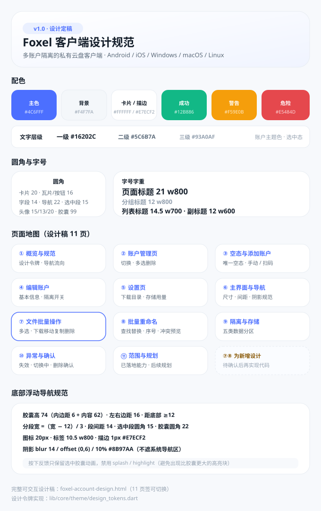

# Foxel 客户端

> 一个**多账户完全隔离**的私有云盘客户端，覆盖 Android / iOS / Windows / macOS / Linux。
> 当前版本 **v1.0.6**

Foxel 客户端连接自建的 Foxel 服务端（如 `https://demo.foxel.cc`），用于浏览、上传、下载、播放服务器上的文件。

与常见云盘客户端不同，它把「**账户**」当作一等公民：**每个账户都是一套独立沙箱** —— 独立登录态、独立下载目录、独立传输队列、独立浏览位置、独立媒体缓存。你可以同时挂着私人服务器、团队服务器、NAS，互不干扰，随时一键切换。

<p align="center">
  
</p>

> 上图是设计规范总览（配色 / 圆角 / 字号 / 页面地图 / 导航规范）。
> 完整可交互设计稿：**[docs/foxel-account-design.html](docs/foxel-account-design.html)** —— 打开后可切换 9 个页签。

---

## 目录

- [一、核心特性](#一核心特性)
- [二、设计稿（9 页）](#二设计稿9-页)
- [三、设计规范](#三设计规范)
- [四、数据隔离模型](#四数据隔离模型)
- [五、技术栈与目录结构](#五技术栈与目录结构)
- [六、构建与发布](#六构建与发布)
- [七、快速开始](#七快速开始)
- [八、已知限制与后续规划](#八已知限制与后续规划)
- [九、版本发布记录](#九版本发布记录)

---

## 一、核心特性

| 特性 | 说明 |
|---|---|
| **多账户沙箱** | 凭证、下载目录、传输任务、浏览位置、媒体缓存五类数据按 `acc_<id>` 分区；切换账户即换指针并重建界面树 |
| **统一空态** | 全新安装或删光账户时，所有平台一致停留在「账户管理页空态」；不自动创建默认账户、不强制弹登录页 |
| **多选批量删除** | 账户管理页右上「编辑」进入多选，可勾选任意账户（含当前账户）批量删除；删空即回到空态 |
| **文件批量操作** | 文件页长按条目或点「选择」进入多选，批量下载 / 移动 / 复制 / 删除；文件夹下载按递归展开为文件队列，受限并发 3 |
| **批量重命名** | 查找替换 / 前后缀 / 序号 / 大小写 / 扩展名五种方式，实时预览新旧名，冲突在预览阶段拦截且不提供强制覆盖 |
| **切换即隔离** | 切换账户中断旧账户任务（可逐账户关闭）、重建页面、恢复该账户上次浏览的位置与排序 |
| **账户级下载目录** | 默认目录优先使用**显示名称**（未填写时用账户 ID）；支持系统目录浏览（桌面返回真实路径、Android 走 SAF）、可写校验与权限引导 |
| **Windows 便携版** | 数据写在 `<程序目录>/userdata/prefs.json`，**删除程序目录 = 清空数据**，不污染系统 AppData |
| **Windows 托盘常驻** | 启动即以托盘模式运行（不弹主窗口），关闭主界面只收进托盘；托盘右键菜单仅「显示主窗口 / 退出」两项，左键双击图标等效显示主窗口；**只有托盘「退出」才真正结束进程** |
| **可靠的删除语义** | 删除账户立即退出其登录态；旧版本会话只迁移一次 + 残留键幂等清理，杜绝「删了又复活」 |
| **桌面端适配** | 宽屏内容最大宽度 720 居中，与移动端版式一致 |

---

## 二、设计稿（11 页）

设计稿共 **11 页**，与实现一一对应；完整可交互版本在 [docs/foxel-account-design.html](docs/foxel-account-design.html)。

| 页面 | 覆盖内容 | 对应实现 |
|---|---|---|
| ① 概览与规范 | 设计令牌、导航流向、页面清单 | `lib/core/theme/design_tokens.dart` |
| ② 账户管理页 | 常规态（点选即切换）、多选删除、批量确认 | `features/accounts/pages/account_center_page.dart` |
| ③ 空态与添加账户 | 唯一空态、手动添加、扫码添加 | 同上（`asRoot` 空态）+ `features/auth/pages/login_page.dart` |
| ④ 编辑账户 | 显示名称 / 服务器地址 / 四项隔离开关 / 危险操作 | `features/accounts/pages/account_form_page.dart` |
| ⑤ 设置页与下载目录 | 当前账户卡、账户管理入口、存储用量、下载目录弹层（含「浏览...」） | `features/settings/pages/settings_page.dart` |
| ⑥ 主界面与底部导航 | 文件页账户条、底部导航尺寸 / 间距 / 阴影规范 | `features/drive/pages/drive_shell_page.dart` |
| ⑦ 文件批量操作 | 长按/「选择」进入多选，批量下载、移动、复制、删除；目标目录选择 | `features/drive/pages/file_browser_page.dart`、`directory_picker_page.dart` |
| ⑧ 批量重命名 | 查找替换 / 前后缀 / 序号编号 / 大小写 / 扩展名；先预览后执行，冲突预览期拦截 | `features/drive/pages/batch_rename_page.dart`、`services/rename_rules.dart` |
| ⑨ 隔离与存储 | 全局层与账户沙箱划分、各平台数据位置 | `core/storage/account_store.dart` 等 |
| ⑩ 异常与确认 | 账户失效、切换中、删除确认 | `lib/app/app_root.dart` |
| ⑪ 范围与规划 | 已落地能力与后续规划 | — |

**关键交互约定**

- **底部导航**：`文件 / 任务 / 设置` 三个 tab；账户管理是设置页内的独立二级页，可在其中点选账户即切换
- **无账户**：直接呈现账户管理页空态（不显示登录页、不显示底部导航），空态是唯一的
- **多选删除**：右上「编辑」→ 勾选（含当前账户）→「删除 N 项」；删除当前账户后自动切到剩余账户，删空即回空态
- **切换反馈**：切换成功 Toast 提示「已切换到 X，数据与其他账户隔离」；失败回滚到原账户
- **失效账户**：列表标「失效」+ 顶部提示条，一键重新验证，本地数据保留

---

## 三、设计规范

| 类别 | 规范 |
|---|---|
| 主色 / 浅底 | `#4C6FFF` / `#EAF0FF` |
| 背景 / 卡片 / 描边 | `#F4F7FA` / `#FFFFFF` / `#E7ECF2` |
| 文字层级 | 一级 `#16202C`、二级 `#5C6B7A`、三级 `#93A0AF` |
| 状态色 | 成功 `#12B886`、警告 `#F59E0B`、危险 `#E5484D` |
| 圆角 | 卡片 20 · 瓦片/按钮 16 · 字段 14 · 底部导航 22 · 导航选中段 15 · 头像 15/13/20 · 胶囊 99 |
| 间距 | 页面边距 16 · 卡片内边距 16 · 常用 8 / 12 / 14 |
| 字号字重 | 页面标题 21 w800 · 分组标题 12 w800 · 列表标题 14.5 w700 · 副标题 12 w600 · 胶囊 11 w800 · 按钮 14.5 w800 · 空态标题 17 w800 |
| 图标 | 列表/设置 20 · 按钮内 18 · 导航 20，统一 2px 描边 |
| 底部导航尺寸 | 胶囊高 74（内边距 6 + 内容 62）· 左右边距 16 · 距底部 ≥12 · 分段宽 `(宽−12)/3` · 段间距 14 |
| 底部导航阴影 | `blur 14 / offset (0,6) / 10% #8B97AA`；按下反馈只保留选中胶囊动画（禁用 splash / highlight） |

所有取值集中在 [`lib/core/theme/design_tokens.dart`](lib/core/theme/design_tokens.dart)，页面不再各自硬编码样式；按钮、输入框、AppBar、对话框、SnackBar 由 [`lib/app/app.dart`](lib/app/app.dart) 的全局主题统一。

---

## 四、数据隔离模型

**全局层（唯一）**

- `foxel_accounts_index`：账户索引（id / 别名 / 服务器 / 头像）
- `foxel_active_account_id`：当前账户指针
- `foxel_migration_v2_done`：旧版本迁移只执行一次的标记

**账户沙箱（每账户一份）**

| 维度 | 存储 key / 位置 | 用户可见效果 |
|---|---|---|
| 登录凭证 | `foxel_acc_<id>_token` | 切换不乱登录态 |
| 下载目录 | `foxel_acc_<id>_download_dir` | 不同账户文件不混放 |
| 传输队列 | 按账户持有控制器 | 任务列表只显示当前账户 |
| 浏览位置 | `foxel_acc_<id>_browse_state` | 切回恢复上次目录与排序 |
| 媒体缓存 | `foxel_acc_<id>_vp_<hash>` | 删账户可彻底清干净 |

四项隔离开关（独立下载目录 / 独立传输队列 / 记住浏览位置 / 独立媒体缓存）按账户生效：关闭后该账户与其他关闭同一开关的账户共用对应资源。

**各平台数据位置**

| 平台 | 位置 |
|---|---|
| Android / iOS | 应用私有目录（卸载即清除） |
| Windows | `<程序目录>/userdata/prefs.json`（便携，删程序即清空） |
| macOS / Linux | 系统应用支持目录 |

---

## 五、技术栈与目录结构

- **框架**：Flutter（Material 3），Dart SDK ≥ 3.11
- **网络**：`http`，自研 `FoxelApi`（JWT / `access_token`）
- **存储**：`shared_preferences`（Windows 上替换为自研 `PortablePrefsStore`：JSON 原子写 + 写队列）
- **媒体**：`media_kit` / `media_kit_video`
- **相机 / 扫码**：`camera` + `zxing2` + `image`
- **文件**：`file_picker`、`open_filex`、`path_provider`
- **CI**：GitHub Actions（`analyze.yml` 静态检查 + 单元/组件测试；`build.yml` 五平台构建）

```
lib/
├─ app/
│  ├─ app.dart              # 全局主题（按钮 / 输入框 / AppBar / 对话框统一）
│  └─ app_root.dart         # 根组件：账户会话、切换、增删、状态推送
├─ core/
│  ├─ api/                  # FoxelApi、二维码登录
│  ├─ models/               # Account、AccountsSnapshot、IsolationPolicy…
│  ├─ storage/              # account_store / download_dir_store /
│  │                        # browse_state_store / portable_prefs_store
│  ├─ theme/                # design_tokens.dart（设计令牌唯一来源）
│  └─ widgets/              # ContentFrame（桌面端宽度收敛）
└─ features/
   ├─ accounts/             # 账户管理页、账户表单、头像
   ├─ auth/                 # 添加账户 / 扫码
   ├─ drive/                # 文件浏览、传输任务、底部导航壳
   ├─ media/                # 视频播放与进度
   └─ settings/             # 设置页

docs/
├─ foxel-account-design.html   # 9 页可交互设计稿
└─ foxel-design-overview.svg   # 设计规范总览图
```

---

## 六、构建与发布

```bash
flutter pub get
flutter analyze
flutter test
flutter build apk --split-per-abi       # Android
flutter build windows --release         # Windows
```

**CI 产物**

| 工作流 | 产出 |
|---|---|
| `analyze.yml` | `flutter analyze` + `flutter test`（含账户管理页组件测试） |
| `build.yml` | 全平台安装包；推送 `v*` 标签时自动发布到 GitHub Release |

**发布产物（按架构选择，点击格式即可下载最新版）**

| 架构 | Windows | macOS | Linux | Android | iOS |
|---|---|---|---|---|---|
| x86-64 (64 位) | [ZIP](https://github.com/david88558855/Foxel.App-2/releases/latest/download/Foxel-windows-x86_64.zip) | — | [TAR.GZ](https://github.com/david88558855/Foxel.App-2/releases/latest/download/Foxel-linux-x86_64.tar.gz) | [APK](https://github.com/david88558855/Foxel.App-2/releases/latest/download/Foxel-android-x86_64.apk) | — |
| AArch64 / ARM64 | — | [ZIP](https://github.com/david88558855/Foxel.App-2/releases/latest/download/Foxel-macos-arm64.zip) | — | [APK](https://github.com/david88558855/Foxel.App-2/releases/latest/download/Foxel-android-arm64-v8a.apk) | [IPA](https://github.com/david88558855/Foxel.App-2/releases/latest/download/Foxel-ios-arm64-unsigned.ipa) |
| ARMv7 (32 位) | — | — | — | [APK](https://github.com/david88558855/Foxel.App-2/releases/latest/download/Foxel-android-armeabi-v7a.apk) | — |

> 也可以到 [Releases](https://github.com/david88558855/Foxel.App-2/releases) 页面按版本下载。

**安装说明**

- **Windows**：解压 ZIP 后运行 `foxel.exe`（便携版，数据在同目录 `userdata/`）
- **macOS**：解压 ZIP 后拖入「应用程序」；首次打开可能需在「系统设置 > 隐私与安全性」中允许
- **Linux**：解压 TAR.GZ 后运行 `./Foxel`
- **Android**：下载对应架构 APK 安装，多数现代设备选 `arm64-v8a`
- **iOS**：IPA 为未签名版本，需通过 AltStore 等工具侧载

---

## 七、快速开始

1. 启动应用（无账户时停在账户管理页空态）
2. 点「添加账户」→ 填入服务器地址（如 `https://demo.foxel.cc`）、账号、密码 →「验证并添加」
3. 添加成功即自动登录并切换到该账户；之后可在「设置 → 账户管理」中切换、编辑、删除

> 测试账号：`demo.foxel.cc`，用户名 / 密码均为 `admin`

---

## 八、已知限制与后续规划

- 扫码添加目前复用登录页（标题「添加账户」），尚未做独立页面
- 「清除本地数据 / 移除账户」不会删除已下载到磁盘的文件（避免误删用户资料）
- 账户级密码 / 生物识别锁：预留未实现
- 网络图片缓存尚未按账户分区
- Windows 托盘常驻：启动后不显示主窗口，需从托盘图标进入；首次启动的通知区域提示取决于系统通知设置
- Windows：托盘图标可能被系统收纳进「隐藏的图标」溢出区（可在任务栏设置里固定）

---

## 九、版本发布记录

| 版本 | 时间 | 说明 |
|---|---|---|
| **v1.0.6** | 2026-10-17 | Windows 系统托盘常驻：启动即隐藏、关闭只收起、仅托盘可退出；支持左键双击显示主窗口（详见 `docs/Foxel-v1.0.6-release-note.md`） |
| **v1.0.5** | 2026-10-17 | 文件批量操作与批量重命名；删除/切换账户竞态、便携版写盘空窗等阻断级修复（详见 `docs/Foxel-v1.0.5-release-note.md`） |
| v1.0.3 | 2026-10-17 | 文件批量操作与批量重命名；macOS 沙箱网络权限修复 |
| v1.0.2 | 2026-10-16 | 账户体系设计定稿；多选批量删除；底部导航点击异常阴影修复；下载目录默认名优先显示名称 |
| v1.0.0 | 2026-09-16 | 首个公开版本：多账户创建 / 切换、文件浏览与传输 |
